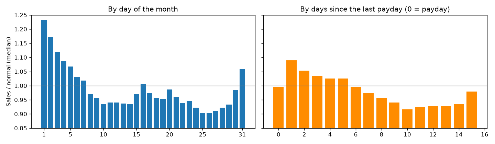
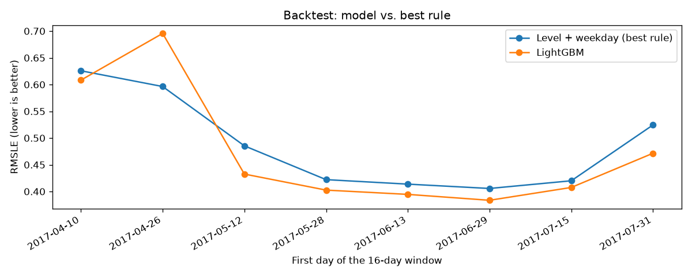

# Store Sales Forecasting

Forecasting daily sales for 54 Ecuadorian grocery stores (Corporación Favorita), 16 days ahead,
using the [Kaggle "Store Sales – Time Series Forecasting" competition](https://www.kaggle.com/competitions/store-sales-time-series-forecasting).

This is a **learning project**: every step is small, and the code is commented to explain
*why* each choice is made, not only *what* it does.

## Why this project is different from the previous ones

In credit risk, house prices and Titanic, every row was independent: the order of the rows did
not matter, so we could shuffle them and use ordinary cross-validation.

In a time series, **order is everything**:

- Yesterday's sales help predict today's sales (this is called *autocorrelation*).
- We must never train on the future and test on the past. That would be *leakage*: the model
  would look great in validation and fail in real life.
- So validation must always be "train on the past, test on the period right after it".

## Roadmap

Each step is one small piece of work. Tick it off when it is done.

- [x] **Step 1 – Project setup.** Folders, dependencies, a function that loads the data
      with real dates.
- [x] **Step 2 – First look.** One store, one product family: plot sales over time,
      spot trend, weekly pattern and holidays. → [01_first_look](notebooks/01_first_look.ipynb)
- [x] **Step 3 – Baselines and the metric.** RMSLE in `src/metrics.py`; five simple rules scored
      on the last 16 days; a forecast that leaks the future. → [02_baselines](notebooks/02_baselines.ipynb)
- [x] **Step 4 – Backtesting.** Score on 8 periods instead of one; a new "level + weekday" rule;
      store closures and back-to-school; first Kaggle submission. → [03_backtesting](notebooks/03_backtesting.ipynb)
- [x] **Step 5 – Features from the calendar.** Day of week, month, paydays, holidays, and the
      first unit tests. → [04_calendar_features](notebooks/04_calendar_features.ipynb)
- [x] **Step 6 – Lag features.** Sales 16+ days ago, rolling means, a leakage test, and the full
      feature table for the model. → [05_lag_features](notebooks/05_lag_features.ipynb)
- [x] **Step 7 – Gradient boosting model.** LightGBM on all stores and families together, early stopping
      without peeking, backtest, submission v2. → [06_lightgbm](notebooks/06_lightgbm.ipynb)
- [x] **Step 7b – Debugging submission v2.** Why Kaggle disagreed with the backtest: two hypotheses, three
      experiments, a fix, submission v3. → [07_debugging_v2](notebooks/07_debugging_v2.ipynb)
- [x] **Step 8 – Extra data.** Promotions help in every window; store info and oil don't. Submission v4.
      → [08_extra_data](notebooks/08_extra_data.ipynb)
- [x] **Step 8b – Unseen promotions.** Why v4 scored worse, and a rule from training data that neutralises promotion
      situations the model never saw. Submission v5. → [09_unseen_promotions](notebooks/09_unseen_promotions.ipynb)
- [ ] **Step 9 – Kaggle submission and write-up.**

## Key findings so far

From one series (store 44, `GROCERY I`, the biggest store and family):

- **Gaps:** Christmas Day is missing from the file every year (stores closed); 1 January has zero sales.
- **Trend:** average daily sales grew about 30% from 2013 to 2017.
- **Weekly pattern:** weekends sell about 50% more than weekdays. This is the strongest pattern.
- **Calendar:** December sells about 40% more than other months; the first days of the month
  (after payday) about 25% more than the last days.
- **Earthquake:** after the 16 April 2016 earthquake, sales tripled for three days.
- **Zeros:** 31% of all rows are zero; a quarter of the 1,782 series sell nothing on most days.

Baselines on the last 16 days of train (2017-07-31 to 2017-08-15):

| Baseline | RMSLE |
|---|---|
| Zero | 4.42 |
| Last day, repeated | 0.659 |
| Same weekday last week | 0.617 |
| Mean of last 4 same weekdays | 0.531 |
| **Mean of last 14 days** | **0.519** |

- **Averages beat single days:** most series are small and noisy, and the metric (RMSLE) gives
  small series a lot of weight.
- **"Yesterday's sales" leaks the future** for a 16-day forecast. It scores 0.546, and still loses
  to the honest 14-day mean.
- **The winner changes by weekday:** weekday rules win on weekends. One 16-day window is not enough
  to pick a winner (step 4).

Backtest on 8 back-to-back 16-day windows (10 April to 15 August 2017):

| Rule | Mean RMSLE | Windows won |
|---|---|---|
| Last day | 0.637 | 0 |
| Same weekday last week | 0.575 | 0 |
| Mean of last 14 days | 0.511 | 2 |
| Mean of last 4 same weekdays | 0.506 | 1 |
| **Level + weekday** (14-day level on the log scale + 8-week weekday profile) | **0.487** | **5** |

- **One window would have picked the wrong rule:** the 14-day mean wins the newest window, but level + weekday
  beats it in 6 of 8 windows.
- **Windows differ more than rules do,** so rules are compared window by window, not only by their averages.
- **Two store closures** (stores 18 and 25, August 2016) wrecked the same-season window a year earlier.
  Without them, level + weekday is again the best.
- **Back-to-school came a month early in 2017.** School supplies peaked around 8 August at over 40 times their
  June level, against early-to-mid September in 2015 and 2016. The test period comes right after the peak.


| Kaggle submission | Method | Backtest RMSLE (8 windows) | Kaggle score |
|---|---|---|---|
| v1 | Level + weekday | 0.487 | **0.41457** |
| v2 | LightGBM | 0.475 | 0.44253 (worse than v1!) |
| v3 | LightGBM, closed store days treated as unknown | 0.443 | **0.40358** |
| v4 | v3 + promotions | 0.419 | 0.41332 (worse than v3) |
| v4b | *Diagnostic only:* v4, with v3's forecasts for 162 rows on 16 August | — | **0.38560** |
| v5 | v4 + guard against unseen promotion situations | 0.422 | **0.38988** (best real model) |

**What went wrong with v2** ([07_debugging_v2](notebooks/07_debugging_v2.ipynb)). The backtest said the model was
better than the rule, Kaggle said it was worse. Comparing the v1 and v2 forecasts showed that half of their difference
came from two stores, 18 and 25, which v2 forecast 3–5 times too low. Both were closed for weeks from mid-August 2016,
and those closed days were training rows with sales 0. The model learned "these stores sell nothing from mid-August"
through the store and calendar columns, and repeated it a year later. The first suspect, `lag_364`, fitted the dates
perfectly, but an experiment ruled it out: removing the closed days as training targets alone fixes the forecasts;
fixing only the features doesn't. None of the 8 backtest windows reaches mid-August, so the backtest couldn't catch it.

**The fix:** a day on which a whole store sold nothing is a closed day. It is not used as a training target, and, like
Christmas, it is "unknown" (NaN) in the features (`closed_store_days` in `src/lags.py`, with a test).
It also fixed store 52, whose pre-opening months had taught the model "store 52 sells nothing": the window after its
opening improved from 0.696 to 0.451. Backtest mean: 0.4745 → 0.4430.

*Notebook 06 shows the results from before this fix; notebook 07 the results after it.*

**Extra data** (notebook 08), each group added one at a time and compared window by window:

| Backtest (8 windows) | Mean RMSLE | Windows better than the row above |
|---|---|---|
| No extras (v3 model) | 0.4430 | — |
| **+ promotions** | **0.4194** | **8 of 8** |
| + store type and cluster | 0.4200 | 4 of 8 |
| + oil price | 0.4189 | 4 of 8 |

- **Promotions are known in advance** (they're in the test file), so the forecast day's own promotions can be used.
  **Future oil prices are not**, even though `oil.csv` contains them, so oil is only used 16+ days old.
- **Promotions win every window; store info and oil win half**, which is what noise looks like. Only promotions are kept.
- **Kaggle disagreed again (v4: 0.41332, worse than v3).** Comparing v3 and v4 showed that 162 rows, 0.6% of the
  test, caused 59% of their difference: on 16 August, **every** store has a promotion in LAWN AND GARDEN, LINGERIE and
  SCHOOL AND OFFICE SUPPLIES, which never happened in training (at most 52–67% of stores). The model extrapolated and
  forecast 3–30 times more than v3. A diagnostic submission, v4 with only those rows taken from v3, scored **0.38560**:
  those rows cost about 0.028, and promotions help everywhere else (−0.018 against v3, close to the backtest's −0.024).
  v4b isn't a real model (the rows were chosen by looking at the leaderboard); a proper fix needs a rule decided from
  the training data alone.
- **The rule** (`guard_unseen_promotions`, notebook 09): per family, the highest share of stores ever on promotion in
  training; above it, promotion features are set to "as usual". It finds exactly the 16 August cases, plus BEAUTY, which
  the manual v4b missed. **In the backtest it costs a little** (0.4194 → 0.4219): promotions grew over time, so a new
  record is usually normal growth. The guard is insurance: validation can only measure its premium, because no backtest
  window contains the rare event it protects against. Keeping it was a judgement informed by the leaderboard.
- **v5 scored 0.38988**: 0.014 better than v3 and 0.023 better than v4, so the rule recovers most of the diagnostic's
  gain without choosing rows by hand. It is 0.004 behind v4b, which differs in two ways (v5 also changes BEAUTY, and
  forecasts the guarded rows with the model rather than copying v3). We don't probe which one: that would be tuning
  on the leaderboard.
- **On open days, promotion days sell about 19% more.** Including closed days (no promotion, no sales) inflated this
  to 36%, and to +1,400% for GROCERY I: the closed-day problem from v2, in an analysis this time.

The Kaggle score is better than the backtest average. The 8 windows ranged from 0.406 to 0.626 and include
the hard April windows; the test period behaved more like the easy June and July windows.
A backtest gives a range, not an exact prediction. (Notebook 06 later showed that the April windows were hard
mostly because store 52 opened on 20 April 2017, not because of Easter.)

Calendar effects across all stores (each day compared with the same weekday in the 4 weeks around it):

- **Payday cycle:** the 1st sells about 23% above normal, the 25th about 10% below, the 31st about 6% above.
  The end-of-month payday matters much more than the mid-month one.
- **Holidays:** the days around Christmas and New Year sell about 26% more; national days off only about 8% more;
  local holidays show no clear effect.
- **The holidays file has traps:** transferred holidays are normal days on their original date, and local and
  regional holidays only apply to stores in that city or state.
- **The Kaggle test period has no national holiday**, but it covers a full payday cycle.



Lag features (built from past sales):

- **Every lag is at least 16 days old**, so one feature table works for all 16 forecast days and can't
  leak the future. A test plants absurd values in the last 15 days and checks no feature changes.
- **This simplicity costs about 0.04 RMSLE** for our best rule (0.487 → 0.528 in the backtest), and much
  more when something just changed: store 52 opened on 20 April 2017, and 16-day-old data still saw it closed.
- **Averages are the best single features:** the 14-day mean of 16-day-old data (0.622) beats even yesterday's
  sales (0.716). Same weekday 3 weeks ago beats a different weekday 16 days ago.
- **The full table:** 3 million rows × 23 columns (lags, calendar, holidays, target), complete for the test period.

LightGBM, one model for all 1,782 series, trained on `log1p(sales)` from 2015 on:

| Backtest (8 windows) | Mean RMSLE | Windows won vs. rule |
|---|---|---|
| Level + weekday (best rule) | 0.487 | — |
| **LightGBM** | **0.475** | 7 of 8 |
| LightGBM, scored without store 52 | — | **8 of 8**, by ~0.03 |

- **The number of trees is chosen without peeking:** early stopping on the 16 days *before* each cutoff,
  then retraining on everything.
- **One new store explains most of the gap:** store 52 opened on 20 April 2017. With 16-day-old features the model
  still sees it closed. Without store 52 the model wins every window, and the "hard" April windows are normal.
- **The rule is still slightly better on day 1** (fresher data); the model's lead grows to about 0.035 by the second week.
- **Dropping the earthquake weeks from training changes nothing** (0.4745 vs. 0.4754), so the data stays.




## Project structure

```
├── data/          # Kaggle files (not committed – see "How to run")
├── images/        # Charts saved by the notebooks (used in this README)
├── notebooks/     # Numbered notebooks, run in order: exploring and explaining
├── src/           # Reusable Python code, imported by the notebooks
│   ├── data.py       # Loading the Kaggle files
│   ├── metrics.py    # RMSLE, the competition metric
│   ├── baselines.py  # Simple forecasting rules, all with the same signature
│   ├── validation.py # Backtesting: cutoffs, splits, scoring every rule on every window
│   ├── features.py   # Calendar and holiday features
│   ├── lags.py       # Lag features from past sales (all at least 16 days old)
│   ├── extra.py      # Extra data: promotions, store info, oil prices
│   ├── dataset.py    # Joins all features and the target into one table
│   └── model.py      # LightGBM: training with safe early stopping, forecasting, backtesting
├── tests/         # Unit tests for src/ (run with `pytest`)
├── submissions/   # Kaggle prediction files
├── pyproject.toml # Settings for pytest
├── requirements.txt
└── README.md
```

**Why split `src/` and `notebooks/`?** Notebooks are great for exploring and showing results,
but code copied between notebooks drifts apart and breaks. Anything used more than once
(loading data, the metric, feature code) lives in `src/` and is imported. One place to fix bugs.

## How to run

1. Join the competition on Kaggle (click "Join Competition" and accept the rules), then
   download the files from the [Data tab](https://www.kaggle.com/competitions/store-sales-time-series-forecasting/data)
   and unzip them into `data/`. You should have `train.csv`, `test.csv`, `stores.csv`,
   `oil.csv`, `holidays_events.csv`, `transactions.csv` and `sample_submission.csv`.
2. Create a separate environment for this project and install the dependencies:
   ```bash
   conda create -n store-sales python=3.11
   conda activate store-sales
   pip install -r requirements.txt
   ```
3. Check that the data loads:
   ```bash
   python -m src.data
   ```
4. In VS Code or Jupyter, choose the `store-sales` environment as the notebook kernel.
5. Run the tests (they don't need the Kaggle data):
   ```bash
   pytest
   ```

**macOS and LightGBM:** if `import lightgbm` fails with `Library not loaded: libomp.dylib`,
install the OpenMP library it needs into the environment:
```bash
conda install -n store-sales -c conda-forge llvm-openmp
```

## Tools

Python · pandas · NumPy · Matplotlib · scikit-learn · LightGBM · pytest · Jupyter
