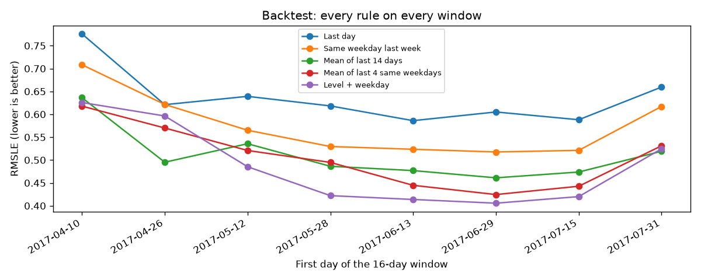
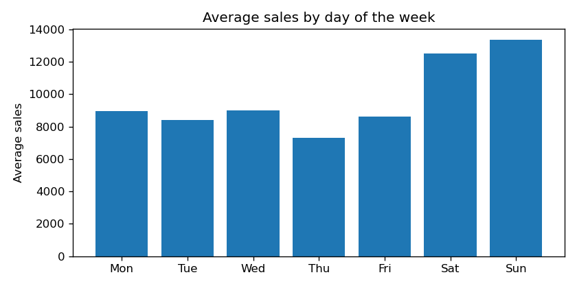

# Store Sales Forecasting

Forecasting daily sales for 54 Ecuadorian grocery stores (Corporación Favorita), 16 days ahead,
using the [Kaggle "Store Sales – Time Series Forecasting" competition](https://www.kaggle.com/competitions/store-sales-time-series-forecasting).

This is a **learning project**: every step is small, and the code is commented to explain
*why* each choice is made, not only *what* it does.

## Why this project is different from the previous ones

In credit risk, house prices and Titanic, every row was independent: the order of the rows did
not matter, so we could shuffle them and use ordinary cross-validation.

In a time series, **order is everything**:

- Yesterday's sales help predict today's sales (this is called *autocorrelation*).
- We must never train on the future and test on the past. That would be *leakage*: the model
  would look great in validation and fail in real life.
- So validation must always be "train on the past, test on the period right after it".

## Roadmap

Each step is one small piece of work. Tick it off when it is done.

- [x] **Step 1 – Project setup.** Folders, dependencies, a function that loads the data
      with real dates.
- [x] **Step 2 – First look.** One store, one product family: plot sales over time,
      spot trend, weekly pattern and holidays. → [01_first_look](notebooks/01_first_look.ipynb)
- [x] **Step 3 – Baselines and the metric.** RMSLE in `src/metrics.py`; five simple rules scored
      on the last 16 days; a forecast that leaks the future. → [02_baselines](notebooks/02_baselines.ipynb)
- [x] **Step 4 – Backtesting.** Score on 8 periods instead of one; a new "level + weekday" rule;
      store closures and back-to-school; first Kaggle submission. → [03_backtesting](notebooks/03_backtesting.ipynb)
- [ ] **Step 5 – Features from the calendar.** Day of week, month, paydays, holidays.
- [ ] **Step 6 – Lag features.** Sales 16+ days ago, rolling means — and why the 16-day
      gap matters (we forecast 16 days ahead).
- [ ] **Step 7 – Gradient boosting model.** LightGBM on all stores and families together.
- [ ] **Step 8 – Extra data.** Oil prices, promotions, transactions: do they help?
- [ ] **Step 9 – Kaggle submission and write-up.**

## Key findings so far

From one series (store 44, `GROCERY I`, the biggest store and family):

- **Gaps:** Christmas Day is missing from the file every year (stores closed); 1 January has zero sales.
- **Trend:** average daily sales grew about 30% from 2013 to 2017.
- **Weekly pattern:** weekends sell about 50% more than weekdays. This is the strongest pattern.
- **Calendar:** December sells about 40% more than other months; the first days of the month
  (after payday) about 25% more than the last days.
- **Earthquake:** after the 16 April 2016 earthquake, sales tripled for three days.
- **Zeros:** 31% of all rows are zero; a quarter of the 1,782 series sell nothing on most days.

Baselines on the last 16 days of train (2017-07-31 to 2017-08-15):

| Baseline | RMSLE |
|---|---|
| Zero | 4.42 |
| Last day, repeated | 0.659 |
| Same weekday last week | 0.617 |
| Mean of last 4 same weekdays | 0.531 |
| **Mean of last 14 days** | **0.519** |

- **Averages beat single days:** most series are small and noisy, and the metric (RMSLE) gives
  small series a lot of weight.
- **"Yesterday's sales" leaks the future** for a 16-day forecast. It scores 0.546, and still loses
  to the honest 14-day mean.
- **The winner changes by weekday:** weekday rules win on weekends. One 16-day window is not enough
  to pick a winner (step 4).

Backtest on 8 back-to-back 16-day windows (10 April to 15 August 2017):

| Rule | Mean RMSLE | Windows won |
|---|---|---|
| Last day | 0.637 | 0 |
| Same weekday last week | 0.575 | 0 |
| Mean of last 14 days | 0.511 | 2 |
| Mean of last 4 same weekdays | 0.506 | 1 |
| **Level + weekday** (14-day level on the log scale + 8-week weekday profile) | **0.487** | **5** |

- **One window would have picked the wrong rule:** the 14-day mean wins the newest window, but level + weekday
  beats it in 6 of 8 windows.
- **Windows differ more than rules do,** so rules are compared window by window, not only by their averages.
- **Two store closures** (stores 18 and 25, August 2016) wrecked the same-season window a year earlier.
  Without them, level + weekday is again the best.
- **Back-to-school came a month early in 2017.** School supplies peaked around 8 August at over 40 times their
  June level, against early-to-mid September in 2015 and 2016. The test period comes right after the peak.



| Kaggle submission | Method | Backtest RMSLE | Public | Private |
|---|---|---|---|---|
| v1 | Level + weekday | 0.487 | *to fill in* | *to fill in* |



## Project structure

```
├── data/          # Kaggle files (not committed – see "How to run")
├── images/        # Charts saved by the notebooks (used in this README)
├── notebooks/     # Numbered notebooks, run in order: exploring and explaining
├── src/           # Reusable Python code, imported by the notebooks
│   ├── data.py       # Loading the Kaggle files
│   ├── metrics.py    # RMSLE, the competition metric
│   ├── baselines.py  # Simple forecasting rules, all with the same signature
│   └── validation.py # Backtesting: cutoffs, splits, scoring every rule on every window
├── submissions/   # Kaggle prediction files
├── requirements.txt
└── README.md
```

**Why split `src/` and `notebooks/`?** Notebooks are great for exploring and showing results,
but code copied between notebooks drifts apart and breaks. Anything used more than once
(loading data, the metric, feature code) lives in `src/` and is imported. One place to fix bugs.

## How to run

1. Join the competition on Kaggle (click "Join Competition" and accept the rules), then
   download the files from the [Data tab](https://www.kaggle.com/competitions/store-sales-time-series-forecasting/data)
   and unzip them into `data/`. You should have `train.csv`, `test.csv`, `stores.csv`,
   `oil.csv`, `holidays_events.csv`, `transactions.csv` and `sample_submission.csv`.
2. Create a separate environment for this project and install the dependencies:
   ```bash
   conda create -n store-sales python=3.11
   conda activate store-sales
   pip install -r requirements.txt
   ```
3. Check that the data loads:
   ```bash
   python -m src.data
   ```
4. In VS Code or Jupyter, choose the `store-sales` environment as the notebook kernel.

**macOS and LightGBM:** if `import lightgbm` fails with `Library not loaded: libomp.dylib`,
install the OpenMP library it needs into the environment:
```bash
conda install -n store-sales -c conda-forge llvm-openmp
```

## Tools

Python · pandas · NumPy · Matplotlib · scikit-learn · LightGBM · Jupyter
